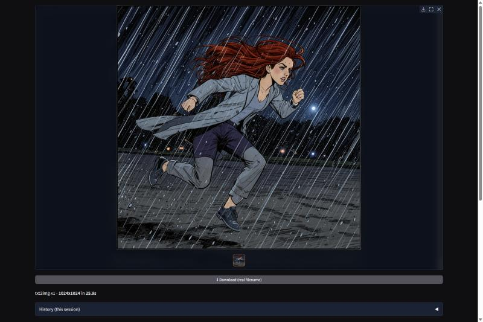
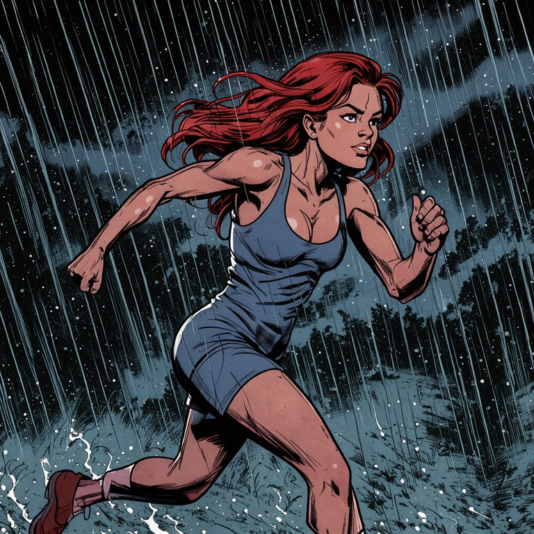
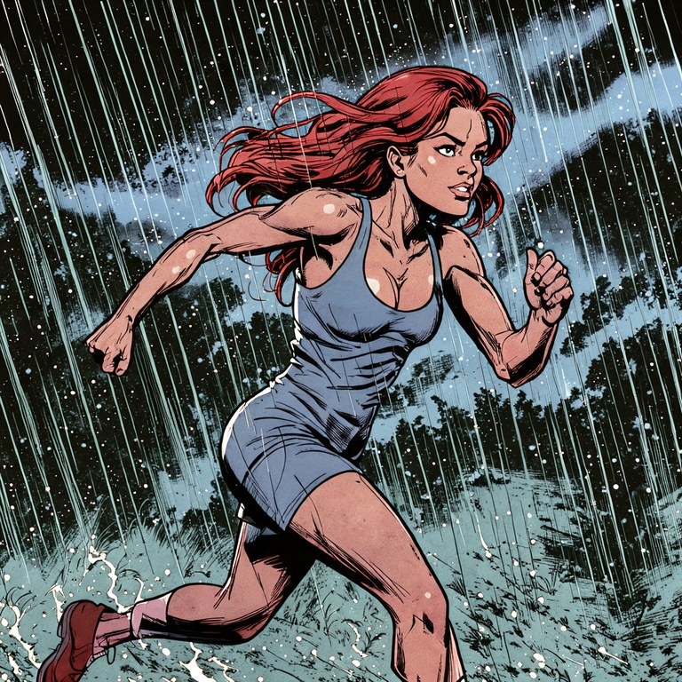
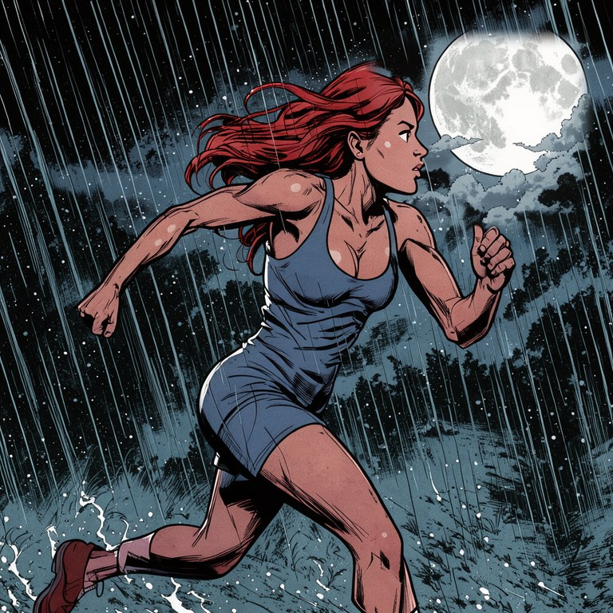

# crispz-flux3

> FLUX.3 Image Klein txt2img + multi-reference editing + upscaler/detailer studio
> (fork of [crispz-klein](https://github.com/mikecastrodemaria/crispz-klein), itself a
> fork of [crispz-qwen-edit](https://github.com/mikecastrodemaria/crispz-qwen-edit) and
> of the Fooocus-style [crispz](https://github.com/mikecastrodemaria/crispz)).
> Current version: **0.1.0**, see [CHANGELOG.md](CHANGELOG.md). The FLUX.2 Klein era of
> this code base (its measurements, its 4B/9B machinery, its decisions) is kept in
> [FORK-klein.md](FORK-klein.md); the port itself, with the RTX 5090 numbers, is in
> [FORK.md](FORK.md).



*The Text -> Image tab, real capture on the RTX 5090: the first image of the session, a
1024x1024 comic panel at 16 steps in 25.9 s with the model load included; the next ones
take about **7 s**.*

### What it produces

| Generate | Edit (1 reference) | Inpaint |
|---|---|---|
|  |  |  |
| `gen`: *"a comic book panel, a woman with red hair running in the rain at night, ink lines, flat colors, dramatic angle"*, 16 steps, 7.1 s | `edit`: *"make it daytime, sunny, blue sky"*, 13.5 s | `inpaint`: *"a large bright full moon behind heavy clouds in the top right corner"* painted into the masked corner, 5.7 s |

The character stays the same across the three images: the edit and the inpaint run in
the **same pipeline** as the generation, with no second model loaded. All three come from
`tests/test_flux3_e2e.py` on an RTX 5090, which you can re-run yourself.

A standalone **FLUX.3 Image Klein** creation + editing tool, **100% local**, no ComfyUI /
SwarmUI. Engine: [`black-forest-labs/flux-3-image-klein`](https://huggingface.co/black-forest-labs/flux-3-image-klein),
a 5.6B transformer with a Qwen3-VL-4B text encoder, **distilled to 16 steps**, under the
**FLUX Kommunity License**.

**What FLUX.3 changes, in two lines.** One model covers the whole surface: text-to-image
and multi-reference editing are the same checkpoint (the references are cited in the
prompt as `<ref_image_0>`, `<ref_image_1>`...), and img2img / inpaint are served by the
same weights through a small adapter (`cz_flux3.py`). Measured on an RTX 5090:
**18.8 GB of VRAM resident for everything**, 1024x1024 in **6.6 to 7.1 s**, an edit with
one reference in 13.5 s.

**Two checkpoints, one selector.** The **distilled** repo (the default) is a 16-step flow
map with **no CFG**: the guidance slider and the negative prompt are inert on it, and the
app says so rather than pretending. The **base** repo
([`flux-3-image-klein-base`](https://huggingface.co/black-forest-labs/flux-3-image-klein-base))
is the undistilled model: about 50 steps, a **real CFG** (3.5 advised) and a working
negative prompt, about three times slower per image. The *FLUX.3 checkpoint* radio in
Models > Checkpoints switches between them (a complete base swap: transformer, VAE and
encoder).

> **Both repos are gated.** The FLUX Kommunity License is free, commercial use included,
> under 5 M USD of yearly revenue (above that, a licence from Black Forest Labs). Accept
> it on the repo page with your Hugging Face account, then give the app a READ token
> (`hf_token` in `config.txt`, env `HF_TOKEN`, or `huggingface-cli login`). Setup in
> [The model (first run)](#the-model-first-run).

On top of crispz's upscaler it adds:

- **Text -> Image**: generate from a prompt, with an optional **Upscale after generate**
  toggle (under the Generate button) that auto-chains each image, txt2img or Reference
  (Edit), through the ESRGAN + refine pipeline, no manual step. CLI equivalent:
  `--txt2img --upscale` (see README_CLI.md).
- **Image -> Upscale** (the crispz pipeline): Real-ESRGAN + diffusion refine, 4K tiling,
  plus one-click **🎲 Vary (subtle / strong)** (pure img2img re-roll of an input image,
  denoise 0.25 / 0.6, Fooocus-style).
- **Job queue**: `+ Queue` snapshots ALL current settings (incl. model, LoRAs) into a
  labeled job list; `Run queue` chains them unattended (overnight batches with different
  models/settings). **⏸ Pause finishes the current job then halts**; **Stop interrupts
  it mid-render and the interrupted job stays queued** (re-run entirely on resume).
  Either way no job is ever lost: the queue is saved to `cache/queue.json` after every
  change/job and **restored at startup**. VRAM is purged automatically only when the
  model changes between jobs.
- **X/Y/Z grid**: vary 1 to 3 parameters (checkpoint, steps, guidance, denoise, ESRGAN
  model, LoRA file, LoRA weight, Performance preset, **full Prompt (A/B test)**, Prompt
  S/R...): every combo becomes a queued job and the run ends with an **annotated contact
  sheet** per Z value (X columns x Y rows) saved in the output folder and shown in the
  gallery. The values fields **autosuggest after 3 typed characters** (checkpoints and
  LoRAs validated at startup for those axes; `__wildcards__` on the Prompt axes),
  up/down + Tab/Enter, comma-separated segments respected.
- **Tag autocomplete** in the prompt/negative fields: suggestions as you type from tag
  CSVs (downloaded once into `tags/`; drop any `.csv` there to add a source) merged with
  your local `__wildcards__`. Dropdown under the caret, up/down + Tab/Enter, Escape;
  popularity-ranked, indexed (sub-ms per keystroke).
- **Inpaint / Outpaint** (one tab, 4 modes): **Brush** repaints a painted mask,
  **Expand sides** outpaints Left/Right/Top/Bottom (+ **Center**) about 30% per side,
  **Expand sides (outpaint LoRA)** does the same through the FLUX.3 Outpaint LoRA (the
  model sees the whole picture on a gray canvas and continues it),
  **Reframe** to a new aspect ratio (**Contain** = keep the whole image and fill the
  borders, **Cover** = crop to fill). All bounded to the model's 1 MP sweet spot (no
  pixel blow-up), with blurred-edge fill + feathered seams for clean blends, an optional
  **Auto-describe** (local captioner, no Ollama, automatic when the prompt is empty) to
  guide coherent fills, and an optional **Harmonize** pass (light img2img refine over the
  whole result) to unify grain/light and remove the "added zone" look. Steps follow the
  model.
- **Remove Background** (rembg) and **Face Swap** with optional **GFPGAN restore**.
- **🔧 Auto face detailer** (ADetailer-style): tick *Detail faces* under Generate. After
  each render (and upscale), faces are detected and each is re-refined at high resolution
  (enlarged crop, img2img, feathered paste). Denoise slider in Advanced;
  `face_detailer*` config keys.
- **Models**: a **FLUX.3 checkpoint** radio (Distilled / Base), a **Precision** radio
  (bf16 / fp8r / nvfp4), one **Checkpoint** dropdown merging the current base repo with
  single-file FLUX.3 checkpoints from a main **and** an optional extra folder, a
  **Transformer override** (diffusers repo/folder), and **multi-LoRA** (configurable
  **1 to 10 slots** + trigger words). Picking a model also auto-syncs the Performance
  preset. Supported single files: `.safetensors` in the BFL, ComfyUI or diffusers layout,
  BFL's pre-quantized **fp8r / nvfp4** files (kept quantized), and **GGUF quants** (kept
  quantized in VRAM). Refused with one sentence, never gigabytes later: a **FLUX.2 Klein
  file** (it runs in crispz-klein; FLUX.3 has the same hidden width as klein-4B, so the
  guard reads the model FAMILY off the tensor names), misfiled LoRAs, files of another
  architecture.
- **Force aspect ratio on Upscale/img2img** (Settings > Aspect ratio): 3-way radio,
  **Off** / **Crop to fit** (centre-crop, Fooocus-style) / **Extend (outpaint)** (the
  missing bands are generated instead, centre kept pixel-for-pixel, seams blended by a
  light pass; config `force_ratio_mode`, `force_ratio_extend_denoise`).
- **Presets (Fooocus-style)** (Settings > ⭐ Presets): **save / load / update / delete**
  presets. A preset bundles prompt, styles, size, steps/CFG, **base repo** + checkpoint,
  transformer and LoRAs, and **Load** switches the model/LoRAs too. Stored in
  `presets/*.json`. A **basic preset is auto-created for every loadable model** (on
  startup and when you Refresh the checkpoint list) if it does not exist yet, named after
  the model, with steps/CFG from its profile. Existing presets are never overwritten;
  skipped models get none. A single-file checkpoint only swaps the *transformer*, so it
  is only meaningful under the base repo that provides its VAE and text encoder, which is
  why the preset records that base and **Load switches to it** when it differs. The swap
  downloads nothing by itself (the weights come at the next Generate) but it does release
  the warm model, so it is announced. A preset whose checkpoint cannot load says what to
  do before explaining why.
- **Seed**: **♻️ Reuse last seed** (refills the real seed of the previous render) + **Fix
  seed** (no +1 per image). A random `-1` seed is resolved to a concrete value so it is
  actually saved in the metadata.
- **Advanced tab**: **metadata scheme** (`crispz` / **a1111** for **Civitai** upload
  compatibility), **read wildcards in order**, **also save pre-upscale image**, live
  **LoRA-slot count**, and the **Hugging Face token** (gated models).
- **PNG Info**: drop an image into *Input Image* to read its embedded **prompt + params**
  (crispz, **A1111/Civitai**, or ComfyUI). **✨ Apply all** loads everything in one click
  (prompt, negative, seed, steps, CFG, size), or send just the prompt / seed.
- **AI provenance (EU AI Act art. 50)**: PNG Info also shows a **Provenance** section.
  **C2PA / Content Credentials** manifests are read automatically (Firefly, ChatGPT,
  Gemini outputs carry them; signature state shown), and **🔍 Check invisible watermark**
  decodes a **TrustMark** watermark on demand (CPU, about 4 s first call then 0.1 s). Set
  `provenance_watermark: "on"` to embed your own invisible TrustMark id (max 9 ASCII
  chars, `provenance_wm_id`) in every saved image; it survives JPEG/WebP re-encoding.
  CLI: `--provenance -i img.png`. Both need `trustmark` / `c2pa-python`
  (`requirements-extra.txt`); absence of marks never means "not AI".
- **Ollama (optional)**: **Describe** (image to prompt, in a **style** you pick),
  **Improve prompt**, and **Vision Mix** (blend several reference images into one
  prompt). Models unload from VRAM after use. Without Ollama, **Describe** uses a local
  BLIP captioner (fully offline); **Improve** (prompt and negative, optional directives)
  needs Ollama.
- **Fooocus-style UI**: big contained preview + batch gallery (arrows + fullscreen),
  prompt + Generate + **Stop**, a **live preview** of the image as it forms, dark theme,
  Settings (aspect/performance/batch **1 to 30**), **277 styles** (search + hover
  previews), and a **crop editor** on every image input.
- **Asset Browser** (standalone gallery, new tab): opens **instantly** (indexing +
  thumbnails in the background, shimmer placeholder then real thumbnail); the thumbnail
  cache can live on a **fast disk** (`asset_browser.cache_dir`, e.g. `"D:/cache"`) when
  the output folder is on a slow HDD/NAS; images save into **`out/YYYY-MM-DD/`** date
  subfolders; a **subfolder sidebar** with counts + per-folder **hide** + a **Hidden**
  toggle (persisted), **defaults to today**; **metadata keyword search**, per-image
  copy/delete, NSFW blur; and **Outputs / LoRAs / Models** source tabs (models show a
  Civitai preview if one sits next to the `.safetensors`, else a placeholder + trigger
  words). A **🔎 Fetch from CivitAI** button (per model, in its lightbox) looks the model
  up by **SHA256** and pulls its **preview + trigger words + example images** (saved as
  `<name>.preview.png` + `<name>.civitai.json`), plus the **community consensus settings**
  (median steps/CFG, shown on the model card, and appliable in one click via **📊 Apply
  CivitAI recommended settings** in Models > Checkpoints; the sampler is never applied,
  FLUX.3 runs its own schedule). The fetch shows **live progress** (spinner + bar: real
  `Hashing... %` when the file must be hashed, then Querying / Downloading) with an
  inline result. **Video examples are accepted too**: the video LoRAs (Wan, LTX...)
  illustrate themselves with `.mp4` "images" on Civitai; the preview and the search cards
  take the **first frame**, and the example viewer **plays the video**. **Example images
  are clickable**: a full-screen viewer shows each example **large with its generation
  prompt** (Copy prompt) and arrows to browse. A small **🖼️ icon** next to each **LoRA**
  dropdown and the **Checkpoint** dropdown (Advanced) opens the Asset Browser **straight
  to that model's card**. A **🔄 Fetch all missing** button (LoRAs / Models tabs) enriches
  the whole folder in one go (same as the standalone `civitai_index.bat` / `.sh`); models
  with a **newer version on CivitAI** get an **update** badge, counting only versions
  published for the **same base model**. A **🖼 Rebuild ALL thumbnails (force)** button
  re-generates every thumbnail of the current tab from scratch (parallel, live progress).
  Plus a per-session history in the app. The **Output folder** can point anywhere (even
  another drive); a folder typed into the UI at runtime is auto-authorised, so the browser
  opens without a Gradio *"File not allowed"* error. (In `config.txt`, write Windows paths
  with `/` or `\\`; a single `\` is an illegal JSON escape.)
- **Metadata saved** with every image: PNG text chunk + EXIF (jpg/webp) + `.json`
  sidecar: prompt, negative, seed, steps, guidance, size, model, base repo, LoRAs,
  **applied style names**. **Dated, unique filenames** (date + tag + seed + size).
- **`config.txt`** for all defaults + the Ollama instruction strings.
- **Edit (references)** native multi-image compose, **live, 4 slots in the tab, up to 10
  references through the CLI and the protocol**. FLUX.3 takes a list of reference images
  and the prompt names them (`<ref_image_0>` is Ref 1), so editing runs in the SAME
  pipeline as txt2img: no second model, no extra VRAM, no extra download.

Tabbed Gradio UI + scriptable CLI + persistent server (`--serve`).

> **CLI cheat sheet:** see **[README_CLI.md](README_CLI.md)** for one-block examples of
> every mode (txt2img, upscale, LoRA, Vision Mix, Remove BG, Reframe, Face Swap, server).

### Launchers (Windows)

| Script | What it does |
|---|---|
| `run.bat` | Standard local launch (127.0.0.1:7860; Gradio takes the next free port if it is busy, the family shares 7860). |
| `xyz_example.bat` | Ready-to-run **X/Y/Z grid** CLI example (`xyz_example.bat "your prompt"`): 2x2 Steps x Guidance, prints the sheet path. Unix: `xyz_example.sh`. |
| `boot_check.bat` | **Smart boot diagnostic**, any GPU (RTX 50xx/40xx/30xx/20xx...): driver, and, the decisive check, whether the installed torch build actually has kernels for your card's `sm_XX`. That is what catches *"RTX 50xx + non-cu128 torch"* (`WinError 127 torch_cuda.dll`) **before** the app crashes, with the exact fix to run. Then reports VRAM and recommends CPU offload / tiling / resolution for *your* card, checks the diffusers FLUX.3 blocks and lists your real model folders (read from `config.txt`, not hardcoded). **Offers GitHub updates first**: an `[UPDATE]` step lists the new commits and asks `Y/N`; no answer in 20 s means N, so the app never updates on its own. It is offered only when the update touches none of your local changes (see below). `--no-run` diagnoses without launching; `--no-update` (or `CRISPZ_NO_UPDATE_CHECK=1`) skips the update step. |
| `boot_check_lan.bat` / `boot_check_web.bat` | Same diagnostic, then **LAN** (`0.0.0.0`) or **Cloudflare tunnel**. **Set a login first**: `"auth": "user:password"` in `config.txt` (or `--auth` / `CRISPZ_AUTH`) shows a login page and gates every route; without it, anyone with the URL can generate and browse/delete your images (see `SECURITY.md`). |
| `update.bat` / `update.sh` | **Update after a GitHub pull**: refuses a `git pull` that would touch a file you modified or overwrite a file present outside git (other local changes, `config.txt`, tests, untracked folders, are kept), reinstalls dependencies **only if the requirements file changed**, warns if `torch` was swapped (a transitive resolve can replace a `+cu128` build with a CPU wheel), re-runs the hardware check, verifies the FLUX.3 blocks still import, and lists **new config keys** added to `config-sample.txt` (your `config.txt` is never overwritten). `--no-pull` / `--force-deps` / `--shared`. |

They set `GRADIO_SERVER_NAME` / `GRADIO_SERVER_PORT` (Gradio reads them) and call `run.bat`.

**Updates at boot.** `boot_check.bat` (and its `_lan` / `_web` wrappers) fetches from
GitHub before the diagnostics (20 s at most: offline, it says so and moves on). With new
commits, it lists up to eight of them and asks `Y/N`; **Y** runs `update.bat` (pull,
dependencies only if the lock changed, torch and pipeline checks), then the boot goes on
with the new version. It offers an update only when it is safe (`_update_check.py`):

- none of the incoming commits touches a file you modified here (git would refuse);
- none adds a file already present here outside git (git would **overwrite** it without
  a word if it is ignored);
- your branch has no local commit missing from GitHub.

Otherwise it names the files in the way, starts the app untouched, and you commit or
stash them before running `update.bat`. Changes elsewhere (`config.txt`, your own tests,
a `wildcards/_backup-*` folder) never block: the pull keeps them.

**Cloudflare (private):** the web launcher reads `cloudflare.local.bat` (your tunnel
name/port); this file is **gitignored**, never committed. Copy
`cloudflare.local.bat.example` to `cloudflare.local.bat` and fill it in. Leave
`CF_TUNNEL` empty for an ephemeral `*.trycloudflare.com` quick tunnel (no personal
config). Needs `cloudflared` (`winget install --id Cloudflare.cloudflared`).

> Roadmap status: **FaceSwap**, **Inpaint/Outpaint** and **multi-reference editing** all
> work on FLUX.3. Planned for 0.2 (see FORK.md): BFL's **prompt upsampler** (edits follow
> a short instruction timidly without it), **bounding boxes** in the Edit tab, the
> fp8r / nvfp4 measurements. See the parent crispz repo for the upscale internals.

## Configuration (`config.txt`)

All defaults and the Ollama prompt strings live in a JSON config. The repo ships a
generic **`config-sample.txt`**; copy it to **`config.txt`** (your local copy,
gitignored) and edit that:

```bash
cp config-sample.txt config.txt    # Windows: copy config-sample.txt config.txt
```

Load order: `config.txt`, then `config-sample.txt`, then built-in defaults. See
**`config_modification_tutorial.txt`** for every key (filename pattern, Ollama prompts,
the FaceSwap model paths, etc.). The model keys are `flux3_model`, `flux3_transformer`,
`flux3_precision`, `flux3_base_repos` and `hf_token`; a `config.txt` copied from
crispz-klein still loads, its `klein_*` keys are simply ignored, and its 4-step `klein`
profile is skipped for FLUX.3 names with a log line.

## Styles, Describe & Improve (Ollama)

- **Styles** tab (Advanced): 277 Fooocus/SDXL styles, a **search** box and a
  **thumbnail preview** gallery. Selected styles wrap your prompt and merge their
  negatives. (Sample thumbnails live in `styles/samples/`, local only.)
- **Describe** (Input Image, Describe): turns an image into a prompt with an Ollama
  **vision** model (detected when the page loads, vision-only list, the last one picked
  is remembered), or with the **caption model** when Ollama is off or fails.
  **Prompt AI, Describe style** sets what the model is asked for:

  | Style | For |
  |---|---|
  | **Prompt (prose)** (default) | rebuilding the image: medium and style first, then subject, clothing, pose, setting with positions, camera, lighting, palette, era, mood; a sign or title quoted once |
  | Prompt (tags) | a comma-separated tag list, most important first |
  | Photo (technical) | shot size, lens, depth of field, lighting setup, grading, grain |
  | Art & style | medium, technique, line work, palette, movement |
  | Composition & layout | where everything sits: planes, left/right, horizon, framing |
  | Character sheet | the main character, head to toe, to draw it again |
  | Text & typography | every legible line quoted, with its font, size, color and place |
  | Dataset paragraph | a training caption: subjects, objects, setting, era, medium, style, then the aspect ratio (after Captionz) |
  | Short caption | one sentence |

  **Length** goes from 60 to 300 words, and the accordion under it shows the exact
  instruction sent. A personal `ollama_describe_prompt` in `config.txt` adds a *Custom
  (config.txt)* style. *Prompt (prose)* is the measured one (2026-09-11, Agents-A1-4B and
  muse-glimmer, each description regenerated at the same seed): naming the medium first
  keeps a drawing a drawing, and a quoted text comes back clean only when it is given in
  one piece; asking for the era (measured 2026-09-12) raised the portrait's fidelity from
  0.54 to 0.65 on both models. The other styles follow the same rules. A small vision
  model (Agents-A1-4B, 3.3 GB) describes in 1-5 s next to the image model; a 28B one
  (muse-glimmer, about 21 GB) is richer but needs the GPU to itself.
- **Improve prompt**: rewrites the current prompt richer, same subject and intent, no
  generic filler. The input **format** is detected in code and kept: a tag list stays a
  tag list, prose stays prose (`ollama_improve.format`: auto | tags | prose | off). The
  `{a|b|c}` variant groups and `__wildcards__` are protected; the console says so if a
  model drops them anyway. On FLUX.3, where the prompt upsampler is not loaded, Improve
  is the tool that turns a short edit instruction into the full target description the
  model follows best.
- **Improve negative**: shown on the base checkpoint only. The negative prompt has no
  effect on the distilled model, so the button is hidden there.
- **Directives**: the small **✎** button next to each Improve opens a box for your own
  instructions for ONE rewrite ("more cinematic, under 60 words, in French"); they win
  over the built-in rules and are never saved. The plain Improve button still works in
  one click.
- **Model**: Advanced, **Prompt AI**, *Improve model* lists **every** installed model
  (a text model is enough). Empty = `ollama_improve.model`, else the first installed
  model.
- **Without Ollama** Improve does nothing and says why (Ollama stopped, no model, empty
  answer from a reasoning model); the text is left untouched.
- **Config** (`config.txt`): the `ollama_improve` block: `enabled`, `endpoint` (empty =
  the Ollama URL), `model`, `timeout`, `temperature`, `keep_alive` (0 = unload right
  after the answer, the GPU is shared with generation), `positive_instruction`,
  `negative_instruction`, `default_negative`, `format`. A custom `ollama_improve_prompt`
  is still honored. The Ollama transport uses `127.0.0.1` (a `localhost` URL is
  rewritten) and ignores system proxy variables.
- **Caption model** (Prompt AI): the Describe fallback and the **Auto-describe** toggle
  in Inpaint / Outpaint. `blip-large` (default, richer), `blip-base` (lighter), local,
  downloaded on first use, or `ollama:<model>`, one of your Ollama vision models (listed
  once Ollama is detected): pick a small one, it runs right before the image model; BLIP
  takes over if Ollama fails. Set by `caption_model` in `config.txt` too.
- Ollama calls send `ollama_num_ctx` (8192) and cap answers at `ollama_num_predict` (700
  tokens); Describe runs at `ollama_describe_temperature` (0.3). A Modelfile default
  context can be 131 072: twice the VRAM for nothing.

## Using a reference image (multi-reference status)

**Available now: img2img.** To guide generation with a reference image, use
**Input Image, Upscale or img2img** (uncheck "ESRGAN upscale" for a pure img2img
refine). One reference image + your prompt. The **strength is a fraction of the
steps**, diffusers' own rule: 0.35 runs 6 of the 16 steps from the matching point of
FLUX.3's shifted schedule.

**Available now: Vision Mix.** Input Image, **Vision Mix** tab: drop up to 4
references, then either *"Vision Mix to prompt"* (fills the prompt) or *"Vision Mix &
Generate"* (one click: blend + generate). A vision model captions each image and the LLM
merges them into ONE prompt (e.g. person + outfit + setting). Needs Ollama with a real
vision model (llava, qwen-vl...) set in Advanced, Prompt AI. The merge instruction is
`ollama_compose_prompt`, and `ollama_vision_blocklist` hides models that wrongly claim
vision; both in `config.txt`. Vision Mix blends ideas/style, not exact pixels: that is
what Edit (references) does.

**Multi-reference compose (person + outfit, etc.)** is **native here**, and this is the
single biggest difference with the rest of the crispz family:

| Fork | Multi-reference | Cost |
|---|---|---|
| crispz-studio (Z-Image) | none, no Omni/Edit model released | none |
| crispz-krea2 (Krea 2) | none, no instruction-edit pipeline exists | none |
| crispz-qwen-edit (Qwen-Image) | yes, via a **separate** Qwen-Image-Edit model | a second 20B model in RAM/VRAM |
| **crispz-flux3 (FLUX.3 Image Klein)** | **yes, in the base pipeline** | **zero: same model, same weights** |

FLUX.3 takes the references as a list of images next to the prompt, so passing several
is just another argument. Nothing to configure, nothing to download, no second model to
keep resident.

### Edit (references), always on

The **Edit (references)** tab is **enabled out of the box**. Drop 1 to 4 reference images,
write the instruction, Generate. **Name the references in the prompt** the way FLUX.3
was trained: `<ref_image_0>` is Ref 1, `<ref_image_1>` is Ref 2, and so on ("put the
jacket of `<ref_image_1>` on the person in `<ref_image_0>`"). The output takes the size
of Ref 1 unless you give one. It runs like txt2img: **Image number** makes a batch (each
image with seed + i, variants and wildcards drawn per image), **Upscale after generate**
chains each image through ESRGAN + refine, and the face / hand **detailer** runs on the
final image. The tab offers 4 slots; the CLI and the `czp` protocol take up to **10**
references, which is the model's limit.

**Write the target, not the verb.** Measured on the 5090: *"make it daytime, sunny, blue
sky"* on the rain scene lightens the sky but keeps the rain, and the raw diffusers
pipeline (official text encoder block, same seed) gives the same pixels: it is the
model, not the app. FLUX.3 ships with a **prompt upsampler** (a 9B model, about 28 GB)
whose job is to rewrite such an instruction into a full description of the result; it
is not loaded in 0.1.0 (it would not fit next to the generator on a 32 GB card) and is
planned for 0.2. Until then, describe the image you want ("the same woman running, in
bright daylight under a clear blue sky, dry ground, no rain, ink lines, flat colors") or
let **Improve prompt** do it.

The upstream `zimage_omni_model` / `zimage_omni_base` config keys are **gone**: there is
no separate editor to point at. Changing the checkpoint changes the editor too, because
they are the same model. The "Edit model" field in Models is kept for API
compatibility with the family and is a no-op.

### What does not exist for FLUX.3 yet

| Approach | Status |
|---|---|
| **ControlNet** | no FLUX.3 ControlNet published yet |
| **IP-Adapter** (what Fooocus uses for image prompts on SDXL) | none, and unnecessary: multi-reference is native |
| **Edit-task LoRAs** | one so far: the CivitAI **Outpaint** LoRA ships as a preset (and as an Inpaint / Outpaint mode); a preset you declare in `config.txt` (`edit_loras`) is picked up at once, see below |
| **Lightning / speed LoRAs** | none; the distilled checkpoint already runs 16 steps, the Edit speed control is hidden until one ships |
| **Bounding boxes** | the model supports them (a 0-1000 grid per reference); the UI does not expose them yet (0.2) |

## Job queue

Queue several generations with different settings and run them unattended.

- **`+ Queue`** (under the prompt area) freezes a complete snapshot: every Generate
  setting **plus the current model state** (base repo, precision, checkpoint/transformer,
  LoRAs + weights). Jobs are self-contained: you can change the model afterwards, each
  job restores its own. The button shows the pending count.
- **Job queue panel** (accordion): labeled list, select a job, **Up / Down / Remove /
  Clear**, then **`Run queue`** to execute in order (normal progress bar, history and
  file saving as usual).
- **Stop = pause**: the current job is interrupted, remaining jobs stay queued; press
  `Run queue` to resume. A failed job logs `[crispz][queue] ...` and the queue continues.
- VRAM purge between jobs happens **only** when the model actually changes (the existing
  model-cache invalidation does the work: zero cost for same-model series).
- Config (`config.txt`): `"job_queue": {"enabled": true}`. Set `false` to remove the
  panel entirely (no components created, zero cost).
- v1 limits: in-memory queue (cleared on page reload), sequential execution.

## X/Y/Z grid

Compare parameter variations side by side on an annotated contact sheet.

1. Open **X/Y/Z grid** (accordion under the Job queue), pick the **X axis** (and
   optionally Y and Z) and type the values, comma-separated; quotes protect commas
   (`"red, bright", blue`). The field's placeholder adapts to the chosen axis, and the
   **`⤵ suggest`** button pre-fills it (app lists for closed choices, calibration values
   for numeric axes); it never overwrites what you already typed.
2. **Build grid, queue**: every combo becomes a job in the Job queue (validated first:
   numbers cast, closed lists matched case-insensitively, combo count capped by
   `max_jobs`).
3. **Run queue**. When the grid has run, one **annotated sheet per Z value** (X in
   columns, Y in rows, 512 px cells, missing cells drawn as placeholders) is saved under
   `<output>/xyz_<timestamp>/` and appended to the result gallery. Pause/resume keeps the
   collected cells, so the final sheet is complete.

Axes: `Checkpoint`, `Steps`, `Guidance`, `Seed`, `ESRGAN model`, `Factor`, `Denoise`,
`Tile`, `Refine tile`, `LoRA` (swap the file in LoRA slot 1), `LoRA + weight` (swap file
*and* weight), `LoRA weight` (all active LoRAs), `Performance` (applies the preset),
`Prompt S/R` (first value = search term, then its replacements; the term must exist in
the prompt). The `Sampler` and `Schedule` axes still exist for the family's sake but
change nothing on FLUX.3 (Euler is its own schedule, see below); `Guidance` only acts
on the base checkpoint.

**Comparing LoRA epochs.** The `LoRA` axis swaps the *file* in slot 1 while keeping the
weight you set in the Models panel: what you want when the same LoRA was trained over
several epochs, or re-uploaded as several CivitAI versions. Hit **`⤵ suggest`** to drop
the full list of available LoRAs into the field, then delete the ones you do not want to
compare. Names match like every other closed list: any unambiguous fragment works, so
`e000020` is enough; an ambiguous or unknown one is rejected at **Build** time, not
mid-series. `None` is a valid value for a LoRA-free control cell, and other active slots
are left untouched. `LoRA + weight` varies both at once, written `name:weight`
(`ollie_e10:0.6, ollie_e20:0.9`); the suggest button pre-fills each entry with the
current weight, so you only edit the numbers. Cell labels show the base name without
extension, trimmed from the *left* so the `_e000020` suffix that tells your epochs apart
stays visible.

Config (`config.txt`): `"xyz_grid": {"enabled": true, "max_jobs": 100, "thumb": 512}`;
requires `job_queue`; `enabled=false` removes the panel entirely.

Also available from the CLI: `--txt2img --xyz "Steps=8,16,24" --xyz "Denoise=0.3, 0.5"`
(see README_CLI.md): same axes and validation, Ctrl+C assembles a partial sheet.

## Variants `{a|b|c}` (prompt and negative)

A prompt can carry *dynamic prompts* variant groups: one option is picked per image.

```
{a|b|c}            one option, picked at random (seed-bound) or in order
{a|}               an empty option: one chance in two of nothing
{2$$a|b|c}         two distinct options, joined with ", "
{1-3$$a|b|c}       between one and three options
{2$$ and $$a|b|c}  custom separator between the picked options
{a|{b|c}}          groups nest, innermost first
```

- **Seed-bound**: same seed, same prompt, same picks. Each image of a batch has its own seed (base + i), so a batch explores the options. A prompt **without** any group makes no random draw: existing prompts and seeds give the same image as before.
- **In order**: the *Read wildcards in order* checkbox (config `wildcards_in_order`) applies to groups too. Image *i* of the batch takes option *i % n* (with CLI `--xyz`, *i* is the cell number).
- **Before `__wildcards__`**: groups resolve first, so a placeholder written in an option that is not picked is never read. A wildcard line may itself contain groups.
- **Negative prompt**: expanded too (its own draw); it acts on the base checkpoint and stays inert on the distilled one.
- **Where**: UI **Generate** (txt2img, img2img, Edit (references)), the **Inpaint / Outpaint** tab, the **job queue** and the **X/Y/Z grid** (the *Prompt S/R* axis works on the raw text, groups included), the **CLI** (`--prompt`, `--negative`, `--xyz` per cell, `--serve`) and the **`czp` protocol**. A style `{prompt}` placeholder is never taken for a group (a group needs a `|` or a `N$$` prefix).
- **`<lora:...>` tags** (read by the `czp` protocol) are taken from the expanded text: a tag inside an option only applies when that option is picked.
- A seed `-1` is resolved to a concrete value **before** expanding (Edit, the Inpaint tab, the CLI and `czp upscale` included), so the picks are replayable and the seed is written to the metadata. The metadata stores the **expanded** prompt.
- The console logs every expansion: `[crispz][Variants] a {red|blue} car -> a red car`.

## Tag autocomplete (prompt fields)

Suggestions appear under the caret while typing in the **prompt** and **negative**
fields (from 2 typed characters in the current comma-delimited token).

- **Keys**: up/down navigate, **Tab / Enter** insert, **Escape** close; click works too.
  Inserted tags get underscores replaced by spaces; `__wildcard__` entries are kept
  verbatim.
- **Sources**: the CSVs in `tag_autocomplete.sources` are downloaded **once** into
  `tags/` (atomic, with console progress). Drop any extra `.csv` in `tags/` to add a
  source: rich format `name,category,count,"alias1,alias2"` or one word per line.
  Your **wildcards** are merged in as `__name__` entries with top priority. Aliases
  match too (shown alongside the tag).
- **Performance**: the index is built once in the browser (popularity sort, dedup,
  2-char prefix buckets, early exit at `max_results`). Timings are logged in the
  browser console: `[tagac] ready in N ms` and a rolling per-keystroke average.
- Config (`config.txt`):
  `"tag_autocomplete": {"enabled": true, "max_results": 8, "sources": [<urls>]}`;
  `enabled=false` downloads nothing and injects no script (zero cost).

## Inpaint / Outpaint (Advanced tab)

One tab with three modes. The image editor, prompt, **Steps** (from the model
Performance) and **Strength** are shared across modes:

- **Brush (inpaint)**: paint a mask over the area to change, describe the result in the
  prompt, run. Brush size is set from the editor toolbar (click the brush icon).
- **Expand sides (outpaint)**: check **Left / Right / Top / Bottom** (or **Center** for
  all four) to grow the canvas about 30% per side; the model fills the new borders
  (edge replication + masked denoise, the inpaint path).
- **Expand sides (outpaint LoRA)**: the same sides, through the
  [FLUX 3 Image Klein Outpaint LoRA](https://civitai.com/models/3003865) (153 MB,
  downloaded on first use into your LoRA folder). The picture is placed on a canvas whose
  new bands are **solid gray**, and the edit path is asked, with the LoRA's trigger
  sentence, to replace the gray with the scene: the model sees the whole image as a
  reference and continues it, which holds composition and lighting better than a masked
  fill. The author advises a weight of **1.5** on the distilled checkpoint (the slider
  under the sides); your prompt is appended to the trigger. Painted areas are grayed and
  redone too, and the original pixels are pasted back over the result.
- **Reframe (ratio)**: pick a target aspect ratio + **Contain** (keep the whole image
  and fill the borders) or **Cover** (crop to fill).

All modes are bounded to the model's **1 MP sweet spot** (no pixel blow-up). Border
fills use a **blurred-edge init + feathered seams** so new content matches the original's
colors, and the unmasked area keeps its full resolution, pixel for pixel: the model
denoises the whole canvas and, at every step, the tokens outside the mask are put back
to the original (FLUX.3 has no inpaint pipeline of its own; this blending lives in
`cz_flux3.py`), then the result is composited over the source.

Tips for clean inpaint / outpaint / reframe:

- **Describe the whole scene, not the patch.** Measured on the 5090: *"a large full
  moon behind heavy clouds"* on its own painted nothing into the masked corner of the
  rain scene; *"a comic book panel, a woman with red hair running in the rain at night,
  a large bright full moon behind heavy clouds in the top right corner, ink lines, flat
  colors"* painted the moon, seamlessly. The model sees the entire image and makes it
  coherent with the prompt; a prompt that describes only the patch describes an image it
  cannot produce. **Auto-describe** runs automatically when the prompt is empty (the
  caption model: local BLIP, or an Ollama vision model) to give it that scene, or check
  it to also prepend a description to your prompt.
- **Strength** 0.65 to 0.8 blends best (keeps the edge colors); 1.0 adds more new detail
  but a more visible transition. The strength is a fraction of the steps.
- **Harmonize** (checkbox) runs a light final img2img refine over the whole result to
  unify grain/light and remove any remaining "added zone" look.
- The caption model is set in **Prompt AI, Caption model** (`blip-large` /
  `blip-base`, or `ollama:<model>`).

## Face Swap, post-process  *(Phase 3, optional)*

Input Image, **Face Swap** tab: a source face + "Apply face swap to result".
Works on any mode (txt2img / img2img / omni). The installer sets up the deps by
default (`insightface` + `onnxruntime-gpu`); skip with `install.bat --no-faceswap`,
or install manually:

```bash
.venv/Scripts/python -m pip install -r requirements-faceswap.txt
```

and an **inswapper model**: drop `inswapper_128.onnx` in the `faceswap/` folder
(auto-detected), or set `faceswap_model_path` / `faceswap_model_url` in `config.txt`.
The face-detection model (buffalo_l) downloads automatically on first use. If the
dep/model is missing, the run still succeeds and the report says `faceswap skipped`.

> The inswapper weights are not redistributed here (license). Get them from a
> Hugging Face mirror, e.g. `ezioruan/inswapper_128.onnx`. Local model files
> (`faceswap/`, `*.onnx`) are gitignored.

### Blending quality

inswapper produces a **128 px** face and insightface pastes it back through a plain
**rectangle**. That rectangle is blind to what is in front of the face: a hand, food,
a microphone or a strand of hair falling over the mouth gets painted over by the
generated pixels. crispz-flux3 therefore does its own compositing, with four passes
you can toggle under *Face Swap, Blending quality* (all on by default):

| Setting | What it fixes | Model (auto-downloaded) |
|---|---|---|
| **Occlusion mask** | objects *in front of* the face are preserved | `dfl_xseg.onnx` |
| **Face-region mask** | no bleed onto hair, neck, clothes, background | `bisenet_resnet_34.onnx` |
| **Colour match** | skin tone / exposure differences between source and target | none |
| **Restore** | the soft 128 px swap, re-synthesised at 512 | `codeformer.onnx` or `gfpgan_1.4.onnx` |

The occlusion mask is the important one: without it, any shot where something touches
the face comes out broken around the mouth. Each model is fetched once into `faceswap/`
and can be pointed elsewhere via `faceswap_occluder_path` / `faceswap_parser_path` /
`faceswap_codeformer_path`. If one is unavailable the pass is skipped with a log line;
the swap still runs. Total cost is about **90 ms per face** on GPU.

The enhancer is `codeformer` by default (`faceswap_restore_model`); its
`faceswap_restore_fidelity` goes from 0 (maximum detail, more generative) to 1 (maximum
fidelity to the swapped pixels); 0.5 to 0.7 suits a 128 px swap. GFPGAN ignores it.

> **Not the same thing as Fooocus's "FaceSwap".** Fooocus conditions the *diffusion*
> on a face embedding (IP-Adapter face), so the whole image is generated coherently and
> occlusion can never break, but the identity is only approximate, and it cannot be
> applied to an existing image. The swap here transfers the *exact* face as a
> post-process. Different trade-offs, not a better/worse pair.

### Where the swap runs, and what it replaces

The swap is the **last** step of a render. The order is: generation (txt2img, img2img
or Edit (references)), then **Upscale after generate**, then the face / hand
**detailer**, then the **face swap**. It runs on every image of a batch, and each
swapped image is saved as its own file, tagged `faceswap`. Two consequences:

- **Turn the face detailer off when the swap is on.** The detailer re-renders faces at
  a larger size, then the swap replaces them anyway: the time is spent for nothing, and
  an identity the detailer drifted is not the one you asked for.
- **Every face found in the result is replaced** by the source face (the largest face
  of the source image). On a group shot, everyone gets the same face.

### One set of models for every crispz app

The five files are the same in every app of the family (about 1.43 GB in total):
`inswapper_128.onnx` (the swap), `codeformer.onnx` and `gfpgan_1.4.onnx` (restore),
`dfl_xseg.onnx` (occlusion mask), `bisenet_resnet_34.onnx` (face-region mask). If
another crispz app already has them, either copy its `faceswap/` folder into this one,
or point `faceswap_model_path`, `faceswap_codeformer_path`, `faceswap_restore_path`,
`faceswap_occluder_path` and `faceswap_parser_path` in `config.txt` to that folder, so a
single copy serves every app. A missing auxiliary model is fetched once from the
facefusion repository on Hugging Face; `inswapper_128.onnx` is never downloaded unless
you set `faceswap_model_url`.

## Try-on and casting: Edit (references) + face swap

Edit (references) can dress a person with a garment from a product shot, and even
change the head, in one edit. The face swap then puts the exact face back. The method
below was worked out on the previous engine (the measurements are in FORK-klein.md) and
carries over; the FLUX.3 figures are still to be taken.

**The method.** Put the person in **Ref 1** (`<ref_image_0>`): that image sets the
pose, the framing, the background and the light, and the output keeps its aspect ratio.
Put the garment in **Ref 2** (`<ref_image_1>`, and a second view of it in **Ref 3** if
you have one), the head to use in the next slot. In the prompt, name each reference by
its tag **and** say what to take from it: "the woman in `<ref_image_0>` keeps her exact
pose..., she now wears the dress from `<ref_image_1>` and `<ref_image_2>`: <short
description of the dress>... her head is the head of the woman in `<ref_image_3>`:
<hair, eyes>". Tags count **filled** slots only: fill them in order, an empty Ref 2
turns Ref 3 into `<ref_image_1>`. A short description of the garment (colour, pattern,
collar, sleeves, hem) anchors the transfer. For a sheer garment, say what is worn under
it ("worn over a matching slip"), or the render may show the body through it.

**Consistency.** No edit-task LoRA exists for FLUX.3 yet, so there is no consistency
preset to lean on: the framing is held by the prompt ("keeps her exact pose and
framing") and by describing the target image in full rather than issuing a verb.

**The limit is the face in a full-body shot.** Edit renders at about one megapixel
whatever the size of Ref 1: in a full-body shot the face is about 100 px high and gets
redrawn. The **face swap** fixes it: with the portrait as the source, the face comes
back to the person's features while keeping the expression of the render. Enlarging
Ref 1 does not help (the output stays at one megapixel): **Upscale after generate**
gives the final definition.

**Recipe for a casting** (person, garment in two views, another person's head):

1. Tab **Edit (references)**: Ref 1 = full-body photo, Ref 2 = garment front, Ref 3 =
   garment side, Ref 4 = portrait.
2. Prompt as above, keeping "the joyful expression of `<ref_image_0>`" (or whatever the
   pose calls for) so the swapped face does not look pasted on a different mood.
3. **Image number** 4, then keep the best.
4. **Upscale after generate** on: ESRGAN x2, Refine off.
5. Face **detailer off**; **Apply face swap to result** on, with the portrait as the
   source face.

## Text -> Image

```bash
# Generate only
python app.py --txt2img --prompt "a serene mountain lake, cinematic" \
    --gen-width 1024 --gen-height 1024 --gen-steps 16 --seed 42 \
    --save-mode local --output-dir out

# Generate then upscale (ESRGAN + diffusion refine)
python app.py --txt2img --prompt "portrait of an old fisherman" --upscale \
    --factor 2 --denoise 0.30 -m 4x-ClearRealityV1_Soft.safetensors \
    --save-mode local --output-dir out
```

In the UI, use the **Text -> Image** tab. The distilled checkpoint runs **16 steps** and
ignores the guidance value; the base checkpoint wants about 50 steps and a CFG of 3.5
(the Performance presets carry both).

### Guidance and negative prompt: it depends on the checkpoint

The **distilled** repo is a *flow map*: every step hands the transformer the next
timestep as well, there is no unconditional branch to turn on, so `guidance_scale` and
the negative prompt change nothing. The app passes 1.0 and says once in the console
when you raised the slider. The **base** repo is a regular flow-matching model with a
real classifier-free guidance: the slider is a CFG (3.5 advised), the negative prompt
works, and **Improve negative** appears.

| Control | Distilled (default) | Base |
|---|---|---|
| **CFG guidance** slider / `--guidance` | none, kept for API compatibility | a real CFG, 3.5 advised |
| **Negative prompt** | none | works |
| **Steps** | **16** (8 as a draft mode, to be measured) | about **50** |
| **Sampler / Schedule** | Euler / sgm_uniform only (greyed out) | the same |

The sampler menus are greyed out on purpose: FLUX.3 runs its native FlowMatch Euler
schedule with a constant shift of 6.93, and a multistep sampler or a remapped schedule
would feed the distilled flow map jumps it was never trained on. The CLI protocol says
all of this honestly: `caps` reports `supports.negative` for the loaded checkpoint, and a
spec carrying an inert `negative` or `guidance` comes back with a `warnings` entry
rather than silently pretending.

## Single-file FLUX.3 checkpoints (Civitai, GGUF, BFL quantized)

```bash
# Pass a .safetensors or .gguf directly as the model (used as the transformer)
python app.py --txt2img --prompt "..." \
    --flux3-model "D:/models/flux3-image-klein-Q8_0.gguf"

# Or keep the HF base repo and override only the transformer
python app.py --flux3-transformer "D:/models/flux3_finetune.safetensors" ...
```

The single file is loaded as the **transformer**; the **VAE and the Qwen3-VL text
encoder** still come from the base repo, so the gated repo is needed even then.
Supported: `.safetensors` in the **BFL**, **ComfyUI** or **diffusers** layout (diffusers
0.42 converts the keys), BFL's **fp8r / nvfp4** pre-quantized files (kept quantized), and
**GGUF** quants such as `unsloth/flux-3-image-klein-GGUF` (kept quantized in VRAM; a
GGUF forces CPU offload `model`, the only mode that puts a quantized model on the GPU).
The ComfyUI "scaled" FP8 dequantizer of the previous engine is not ported: FLUX.3 ships
its own fp8r build, and such a file would be handed to diffusers as is, with a log line.

**What is refused, and why it is refused early.** FLUX.3 Image Klein has the same hidden
width (3072) as FLUX.2-klein-4B, so a check on the tensor shapes would wave a FLUX.2
file through and let it die gigabytes later inside `load_state_dict`. The app reads the
model **family** off the tensor names instead (`early_stream_modulations`,
`mode_blocks`... against `double_blocks`, `single_stream_modulation`...), for
checkpoints and LoRAs alike, header only. A FLUX.2 file is refused with one sentence,
"it runs in crispz-klein", counted once per listing rather than once per file; a stray
LoRA in the checkpoints folder and files of another architecture are skipped with their
reason in the console.

## Switching models in the UI (Advanced, Models)

**Models > Checkpoints** holds three controls:

| Control | Choices | What it changes |
|---|---|---|
| **FLUX.3 checkpoint** | Distilled / Base | the whole base repo: transformer, VAE and encoder are reloaded; steps and CFG follow the profile (16 / 1.0 or 50 / 3.5) |
| **Precision** | bf16 / fp8r / nvfp4 | which build of the official transformer is downloaded and run; only the transformer is swapped on the next run (VAE and encoder stay in VRAM); ignored while a single file is picked |
| **Checkpoint** | the current base repo, then your single files | a single file replaces the transformer only |

| Precision | Download | Who runs it |
|---|---|---|
| **bf16** | `transformer/`, about 11 GB | every card; whole in VRAM from 24 GB (18.8 GB resident measured) |
| **fp8r** | `variants/fp8r/`, about 6.3 GB | fast from compute capability 8.9 (RTX 40xx / 50xx); it still runs below, dequantized per layer |
| **nvfp4** | `variants/nvfp4/`, about 5.3 GB | RTX 50xx (Blackwell) with the `flashinfer` package; elsewhere the load fails with its reason |

Picking a base repo swaps everything and says, before the first run, what the repo
costs: the licence, the gated access, the VRAM. The choice is written to
`preferences.json` (`flux3_model`, `flux3_precision`) so the next launch starts on it. A
checkpoint the list refuses is **refused on selection**, with the reason, instead of
failing mid-run.

**Switching between two single files (or clearing an override) reloads only the
transformer**: the VAE, the Qwen3-VL encoder and the tokenizer stay in VRAM, so it takes
seconds instead of a full reload. Only picking a **different base repo** reloads
everything. Same for LoRAs: they are hot-swapped, and changing just a weight is instant.

Steps:

1. **Models, Checkpoints folder** (and, if you keep models elsewhere, **Extra
   checkpoints folder**), **Refresh**. Both folders feed the single dropdown.
2. Pick an entry in **Checkpoint**: the base repo or a local file.
3. **Generate**: it loads with your selection.

**Persist the folders** (so you do not re-type them) in `config.txt`:

```json
"checkpoints_dir": "C:\\path\\to\\models\\FLUX3",
"checkpoints_extra_dir": "",
"loras_dir": "C:\\path\\to\\models\\Lora"
```

### Community full-repo models

Some community models ship as a **full diffusers repo** but with an **incomplete
tokenizer**, so loading them as the **base** fails. Load just their **transformer**
instead and keep the base components:

1. **Models, "Transformer override (HF repo / diffusers folder)"** = the repo,
   **Apply**.
2. Keep the **FLUX.3 checkpoint** selector on the official repo (it provides the VAE,
   the Qwen3-VL encoder and the tokenizer).
3. **Generate** (downloads the transformer once, about 11 GB in bf16).

CLI equivalent: `--flux3-transformer <repo-or-folder>`.

> FLUX.3 is weeks old, so the community fine-tune scene is still thin. The loading path
> is the one inherited from the previous forks and it is tested on synthetic files;
> expect few models to point it at for now.

### Text encoder

FLUX.3 reads eight hidden states of its own **Qwen3-VL-4B** and nothing else fits that
slot yet, so the **Text encoder** control of the previous engine (a replacement Qwen3)
is greyed out, and the encoder is not trimmed either (the pruning was written for a
plain Qwen3; the app says so once at load time, `trim_text_encoder: false` silences it).
A `text_encoder` value left in a `config.txt` from crispz-klein is kept but not applied,
and the image metadata records it as `text_encoder_not_applied`.

### LoRA (up to 3, combinable)

**Models, LoRA**: set the folder, **Refresh**, pick **up to 3 LoRAs**, each with its own
**weight** (range **`-2..2`**, configurable via `lora_weight_min` / `lora_weight_max`). A
**negative weight inverts the LoRA's effect**: a "skinny slider" LoRA at `-1` pushes the
other way; `0` disables it. They are combined (`set_adapters`) on the transformer (shared
by txt2img / img2img / edit) and applied on the next run **without reloading the
model**: changing a weight is instant, swapping LoRA files takes about 1 s. Selecting
LoRAs auto-fills their merged **keywords / trigger words** (read from the file
metadata); **Add to prompt** appends them. FLUX.3 LoRAs only: a FLUX.2 Klein LoRA is
refused with its reason (its layers do not exist in FLUX.3, peft would match nothing).

**LyCORIS LoKr.** A LoKr is not a LoRA: its update is a Kronecker product, `dW = w1 (x)
w2`, and neither peft nor diffusers can apply one. It is supported by **merging it into
the weights** at load: drop it in the LoRA folder and pick it in *Models, LoRA* like any
other. The trade-off, stated plainly: a merge is not an adapter. Changing which LoKr is
selected, or its weight, reloads the transformer (the app detects it and says so), where
a PEFT LoRA is swapped in place. LoHa is *not* supported and is refused by name.

**Extra LoRA folders**: `loras_extra_dirs` (config, or the textbox under the LoRA
folder, or `--loras-extra-dir`) merges other libraries, e.g. a shared Civitai folder,
into every LoRA list. On a duplicate file name the main folder wins.

### Edit LoRA presets

The edit (Edit (references) tab, protocol op `edit`) runs on the **same** pipeline as
txt2img: the LoRA slots above apply to edits too, and the **Edit LoRA presets** dropdown
under the reference images adds its preset on top. The catalogue ships **one** preset,
**Outpaint** (the CivitAI FLUX 3 Image Klein Outpaint LoRA, 2026-10-28, weight 1.5):
pick it, put a hand-made gray canvas in Ref 1 and use its example prompt, or let the
Inpaint / Outpaint tab build the canvas for you (mode *Expand sides (outpaint LoRA)*).
The consistency presets of the previous engine are FLUX.2 files and are not listed.
Declare another one in `config.txt` and it appears in the dropdown, downloads from
Hugging Face on first selection into `<loras_dir>/_hf-edit/<adapter>.safetensors` (or
reuses a copy found in one of your LoRA folders), and picking it sets the weight slider
to its advised value:

```json
"edit_loras": {
  "Relight": {"repo": "someone/flux3-relight-lora", "weights": "relight.safetensors",
              "adapter_name": "relight-f3", "prompt": "Relight the scene with a warm sunset.",
              "inputs": 1, "weight": 0.7}
}
```

The **Edit LoRAs** checkbox in Models, LoRA switches the whole edit set on/off without
losing the selection; `edit_loras_dir` moves the folder. The **Edit speed** control
(Lightning LoRAs) is hidden until a FLUX.3 speed LoRA exists: the distilled checkpoint
already runs 16 steps.

## Disabling the upscale (pure txt2img / pure img2img)

- **txt2img only** (no upscale): the default. Do not pass `--upscale` (CLI), or leave
  the "Upscale after generation" checkbox off (UI).
- **img2img only** (refine without ESRGAN enlargement): `--no-esrgan` (CLI), or
  uncheck **"ESRGAN upscale"** in the Image -> Upscale tab. The diffusion refine runs
  on the input at its native size.
- **ESRGAN only** (fast upscale, skip the slow refine): `--no-refine` (CLI, shortcut
  for `--denoise 0`), or uncheck **"Refine (img2img)"** in the Image -> Upscale tab.
  The two stages are independent toggles: the diffusion refine runs at the *upscaled*
  resolution, so it is the slow part; turn it off when you just want a clean enlarge.

```bash
# img2img only: diffusion refine on the input, no enlargement
python app.py --cli -i in.png --no-esrgan --denoise 0.30 --save-mode local --output-dir out

# ESRGAN only: fast upscale, no diffusion refine
python app.py --cli -i in.png -m 4x-ClearRealityV1_Soft.safetensors --no-refine \
    --factor 2 --save-mode local --output-dir out
```

---

## Installation

### Requirements

- **Python 3.11 or newer** (3.13 advised): `diffusers 0.42.1`, the first release with
  FLUX.3, and Pillow 13 are not published for 3.10. The installers pick 3.13, then 3.12,
  then 3.11, and refuse older ones.
- An NVIDIA GPU. Measured on an RTX 5090 (32 GB) in bf16: 18.8 GB resident, 23.7 GB
  peak. A 24 GB card runs bf16 whole; a 16 GB card gets CPU offload `model`
  automatically, or picks fp8r / nvfp4 in the Precision selector.
- A Hugging Face account that accepted the FLUX.3 licence (see
  [The model (first run)](#the-model-first-run)).

### Provided install scripts

```bash
# Linux / macOS / WSL
./install.sh
./run.sh           # Gradio UI + hardware detection
./cli.sh           # interactive CLI with preferences

# Windows
install.bat
run.bat
cli.bat
```

By default the install scripts create an **isolated `.venv`** from
`requirements-lock.txt`: the exact versions of an environment really resolved and
imported here (torch 2.11 + CUDA 12.8, diffusers 0.42.1, transformers 5.x, Pillow 13),
about 3.5 GB of torch to download the first time. They also:

- set `PYTHONUTF8=1` (the `trustmark` package builds from a source archive whose setup
  script is not cp1252-safe on Windows),
- install Pillow 13 apart, with `--no-deps`: gradio 5.50 declares `pillow<12` while the
  image-decoding CVEs are only fixed in 13, and the combination is checked against this
  code base,
- automatically uninstall a broken `xformers` (built for the wrong torch: DLL load error
  when diffusers loads),
- verify that `diffusers.modular_pipelines.Flux3DistilledAutoBlocks` imports,
- create the `upscale_models/` folder.

`install.bat --shared` (or `install.sh --shared`) creates the venv with
`--system-site-packages` instead, inheriting your global torch and installing the rest
from `requirements.txt` (wide bounds, versions nobody chose). `run.sh` / `cli.sh` (and
the `.bat`) automatically use `.venv` if it exists.

### venv or not: the `--no-venv` flag

The venv is the default (keeps your global Python clean). To install/run directly on
the current interpreter instead, pass `--no-venv` (or `--system`) to any script:

```bash
./install.sh --no-venv      # install on the current Python
./run.sh --no-venv          # run on the current Python
```

```bat
install.bat --no-venv
run.bat --no-venv
```

If venv creation fails, the scripts fall back to the current Python automatically.

Equivalent manual install (an isolated venv, Windows):

```bat
py -3.13 -m venv .venv
.venv\Scripts\python -m pip install --upgrade pip setuptools wheel
set PYTHONUTF8=1
.venv\Scripts\python -m pip install -r requirements-lock.txt
```

### Known environment pitfalls

- **Python 3.10.** `pip` answers *No matching distribution found for diffusers==0.42.1*
  (and the same for Pillow 13): both require 3.11+. Install 3.13 and run the installer
  again.
- **Incompatible `xformers`.** If an `xformers` version is installed but built for a
  different torch, diffusers crashes with `DLL load failed while importing _C` when
  loading the VAE. Fix: `pip uninstall xformers`. The native SDPA in torch 2.7+ is
  enough.
- **`transformers` 4.x.** diffusers 0.42.1 wants `huggingface-hub>=1.32` and
  transformers 4.x pins `huggingface-hub<1.0`: pip cannot resolve the two together
  (`ResolutionImpossible`). transformers 5.x is required, the lock carries 5.21.
- **torchvision from PyPI.** It must come from the same index as torch (`+cu128`), or
  `operator torchvision::nms does not exist` breaks every transformers vision import;
  the lock pins both from the cu128 index.
- **Gradio pinned `<6`.** Gradio 6's Brotli middleware has an h11 bug that spams
  `Too little data for declared Content-Length` in the console when a response is
  interrupted (non-fatal, but noisy). Requirements pin `gradio<6` to avoid it.

---

## Configurable paths (ESRGAN_DIR + the FLUX.3 model)

Two paths are configurable, persisted in `preferences.json`. Resolution order on
each launch:

1. Environment variable (`ESRGAN_DIR`, `FLUX3_MODEL`)
2. `preferences.json` at the project root
3. Default: `./upscale_models` for ESRGAN, `black-forest-labs/flux-3-image-klein` for the model

Three ways to change them:

- **Gradio UI**: **Advanced, Models** tab. Pick the model (the **FLUX.3 checkpoint**
  selector, or a single file in the **Checkpoint** dropdown; it reloads on next
  Generate), set the **Checkpoints / Extra checkpoints / ESRGAN** folders, then
  **Refresh ESRGAN** or **Save paths** (writes `preferences.json`).
- **CLI**: `--esrgan-dir <path>`, `--flux3-model <repo_or_path>`, `--save-paths` to
  persist (with or without `-i`).
- **Interactive CLI** (`cli.sh` / `cli.bat`): first prompt = ESRGAN folder + FLUX.3
  model. Saved to `preferences.json` if you choose to keep them.

`flux3_model` accepts an HF repo (`black-forest-labs/flux-3-image-klein` or `-base`), a
local path to an already-downloaded `diffusers` folder, or a single-file checkpoint.
`flux3_precision` (bf16 / fp8r / nvfp4) and `flux3_transformer` sit next to it; the env
names are `FLUX3_MODEL`, `FLUX3_TRANSFORMER`, `FLUX3_PRECISION`.

## ESRGAN models

Drop at least one `.pth` or `.safetensors` into `./upscale_models`, or point
`ESRGAN_DIR` (env or prefs) at an existing folder.

A few useful picks:
- `RealESRGAN_x4plus.pth` (general)
- `4x-UltraSharp.pth` (sharp, versatile)
- `4x-ClearRealityV1_Soft.safetensors` (soft, good on portraits/scenes)
- `4xFaceUpDAT.pth` (portraits/faces)

`spandrel` detects the architecture and the scale (x2 / x4) automatically.

---

## The model (first run)

No file to provide: on first launch, `diffusers` fetches the FLUX.3 transformer (in the
chosen precision), the VAE and the Qwen3-VL-4B text encoder from Hugging Face, about
20 GB in bf16, then everything is cached locally (`%USERPROFILE%\.cache\huggingface`).
Subsequent runs are offline.

**The gate.** Both repos are gated, so the Hub refuses them until two things line up,
and they are two *different* things, which is where the time gets lost:

**1. Accept the licence**, at
<https://huggingface.co/black-forest-labs/flux-3-image-klein> (and on the `-base` page
if you use it: each repo has its own gate). It is `gated: auto`, no queue, no review, it
takes effect at once.

**2. Give the app a token from that same account.** Either:

```bat
huggingface-cli login          REM read token, picked up without restarting the app
```

or `"hf_token": "hf_..."` in `config.txt` (read at import, restart), or the field in
**Advanced, Models** (applied immediately and persisted), or the `HF_TOKEN` environment
variable.

> **The trap: the account that accepted the licence must be the account the token
> belongs to.** A token that lists the repo's files fine (the metadata is public) still
> gets `GatedRepoError: you are not in the authorized list` on the first weight file if
> the licence was accepted while your browser was logged in as someone else. Check who
> the app actually is with `huggingface-cli whoami`.

If the Hub refuses, the app does not hand you a `huggingface_hub` traceback: it says the
repo is gated, links the page to accept, and tells you whether a token is being sent at
all, so you know which of the two halves is missing.

**Loading progress.** The first load downloads several GB and then reads them into
VRAM; afterwards a load takes 50 s cold (disk cache empty) and about 22 s warm on an NVMe
drive. The terminal shows a live one-line status (`[crispz][load] FLUX.3 Image Klein ...
9s | 14.9 GB in VRAM`, or `... (downloading / reading, first run only)` before
allocation starts) and the UI progress bar advances with it. Turn it off or tune it in
`config.txt`: `"load_progress": {"enabled": true, "target_vram_gb": 19.0,
"heartbeat_s": 2.0}` (`enabled: false` loads directly with no monitor thread).

---

## Running

### 1) Gradio UI (default)

```bash
python app.py
```

UI at http://127.0.0.1:7860. It includes:

- **Before/after slider** (`gradio_imageslider`) that overlays source and result
  with a mouse cursor. Falls back to two side-by-side images if the component is
  not installed.
- **Timing report** under the image: ESRGAN, diffusion refine, total, source path,
  save path.
- **"Save" section** with the same modes as the CLI.
- **Batch mode**: if you fill in "OR source folder", the uploaded image is ignored
  and the app processes the whole folder.

### 2) Scriptable CLI

```bash
# Single image, explicit settings
python app.py --cli -i my_image.jpg \
    --save-mode local --output-dir out --output-format png \
    -m 4x-ClearRealityV1_Soft.safetensors \
    --factor 2 --denoise 0.30 --steps 16 --tile 760 --overlap 32

# Batch over a whole folder
python app.py --cli -i ./my_images --save-mode local --output-dir out --output-format webp

# Save next to each source ("alongside" mode)
python app.py --cli -i ./my_images --save-mode alongside --output-format jpg

# Display only (no file written), just the timing on stdout
python app.py --cli -i my_image.jpg --save-mode display --denoise 0

# With a TSV log to track timings
python app.py --cli -i ./my_images --save-mode local --time-log runs.tsv
```

### 3) Interactive CLI with preferences

```bash
./cli.sh   # or cli.bat on Windows
```

Prompts for each setting (paths, models, source, pipeline, save, time-log) with a
default value from `preferences.json`. Offers to save the choices at the end of the
session.

### 4) Tests

```bash
.venv/Scripts/python -m pytest tests -q            # the CPU suite (tiny random models, no download)
.venv/Scripts/python tests/test_flux3_e2e.py       # the GPU end-to-end run (needs CUDA + the gated repo)
```

The e2e renders the five images at the top of this page, prints a timing per step and
the VRAM peaks, and skips itself cleanly without CUDA or without access to the repo.

## Presets (use cases)

A "Use case" dropdown in the UI (and `--preset` on the CLI) fills the settings for a
given scenario. On the CLI, any explicit flag overrides the preset.

| Preset | What it sets |
|---|---|
| `Custom` | Nothing (default). |
| `Photo (balanced)` | factor 2, denoise 0.30, 12 steps. |
| `Subtle (clean-up)` | factor 2, denoise 0.12, 16 steps. Stays very close to the input. |
| `Detailed (creative)` | factor 2, denoise 0.40, 16 steps. More invented detail. |
| `Portrait (faces)` | factor 2, denoise 0.22, 14 steps. |
| `4K (tiled)` | factor 4, tile 1024, overlap 64, `--cpu-offload model`. |
| `Low VRAM (8-12GB)` | ESRGAN tile 512, diffusion tile 1024, `--cpu-offload sequential`. |

```bash
python app.py --cli -i in.png --preset "4K (tiled)" --save-mode local --output-dir out
python app.py --cli -i in.png --preset "Detailed (creative)" --denoise 0.32   # flag wins
```

## Mapping UI <-> CLI <-> preferences.json

Every UI setting has a CLI flag and a prefs key:

| UI / interactive CLI | CLI flag | preferences.json | Default |
|---|---|---|---|
| ESRGAN_DIR | `--esrgan-dir` | `esrgan_dir` | `./upscale_models` |
| FLUX.3 model | `--flux3-model` | `flux3_model` | `black-forest-labs/flux-3-image-klein` |
| Precision | (config / UI) | `flux3_precision` | `bf16` |
| Source image | `-i` (file or glob) | - | - |
| Batch source folder | `-i` (folder) or `--input-folder` | - | - |
| ESRGAN model | `-m` / `--model` | `model` | `4x-ClearRealityV1_Soft.safetensors` |
| Use-case preset | `--preset` | - | `Custom` |
| Upscale factor | `--factor` | `factor` | `2.0` |
| Denoise (strength) | `--denoise` | `denoise` | `0.30` |
| Skip refine (ESRGAN only) | `--no-refine` | "Refine (img2img)" checkbox (off) | refine on |
| Diffusion steps | `--steps` | `steps` | `16` |
| Prompt | `--prompt` | `prompt` | `""` |
| Seed | `--seed` | `seed` | `-1` |
| ESRGAN tile | `--tile` | `tile` | `760` |
| Overlap | `--overlap` | `overlap` | `32` |
| Sampler | `--sampler` (accepted, Euler is applied) | greyed dropdown | `euler` |
| Sigma schedule | `--schedule` (accepted, sgm_uniform is applied) | greyed dropdown | `sgm_uniform` |
| CPU offload (diffusion) | `--cpu-offload` | - | `auto` |
| Diffusion tile (4K+) | `--refine-tile` | "Diffusion tile" dropdown | `0` = **Auto** |
| Diffusion tile overlap | `--refine-overlap` | - | `64` |
| Save mode | `--save-mode` | `save_mode` | `display` |
| Output folder | `--output-dir` | `output_dir` | `out` |
| Output format | `--output-format` | `output_format` | `png` |
| Time log (CLI) | `--time-log <file.tsv>` | `time_log` | (empty) |
| Save paths (CLI) | `--save-paths` | - | - |
| List models (CLI) | `--list-models` | - | - |
| VRAM peak on stderr (CLI) | `--report-vram` | - | - |
| Output path only (CLI) | `--print-output` | - | - |

Save modes:

| save_mode | Behavior |
|---|---|
| `display` | Writes nothing. UI renders the image + timing. CLI prints the report. |
| `local` | Writes to `output_dir`, resolved **relative to the project** if not absolute. |
| `alongside` | Writes to the **same folder as the source**. Requires a source path (CLI or batch folder). |
| `custom` | Writes to `output_dir` as-is (typically an absolute path). |

Default naming: `{source_name}_upscaled.{png|webp|jpg}`. On the CLI, `-o` accepts
a file (overrides auto naming), a folder (equivalent to
`--save-mode local --output-dir <folder>`), or is omitted (uses
`--save-mode` / `--output-dir`).

Full `preferences.json` example:

```json
{
  "esrgan_dir": "C:/path/to/models/ESRGAN",
  "flux3_model": "black-forest-labs/flux-3-image-klein",
  "flux3_precision": "bf16",
  "model": "4x-ClearRealityV1_Soft.safetensors",
  "factor": 2.0,
  "denoise": 0.30,
  "steps": 16,
  "prompt": "",
  "seed": -1,
  "tile": 760,
  "overlap": 32,
  "save_mode": "local",
  "output_dir": "out",
  "output_format": "png",
  "time_log": ""
}
```

## Timing report

`run()` returns (and prints / logs) the time of each stage:

- `esrgan` : stage 1 (Real-ESRGAN + Lanczos resize)
- `refine` : stage 2 (img2img through the FLUX.3 adapter). 0s if `denoise <= 0`.
- `total`  : sum

crispz also prints `[crispz] ...` stage logs to **stderr** (loading ESRGAN, loading
or reusing the pipeline, stage timings, per-tile progress). This fills the
otherwise-silent model-load gaps and tells you whether a run reloaded the pipeline or
reused the cached one. Silenced with `--quiet`; on stderr, so it never pollutes
`--print-output`.

The UI shows a Markdown block under the image. The CLI prints the report on
stdout (unless `--quiet`). With `--time-log <file>`, each run appends a TSV line:

```
<iso-timestamp>\t<src>\t<dst>\tesrgan=2.24s\trefine=1.87s\tmode=local\tfmt=png
```

---

## External integration (Fooocus, scripts)

Two flags make it easy to call crispz from another tool (separate process):

- `--print-output` : stdout contains ONLY the absolute path of each saved image
  (one per line), nothing else. The human-readable report is suppressed. This is
  the machine-parsable contract for retrieving the result.
- `--report-vram` : run VRAM peak on **stderr** (line `[VRAM] peak allocated:
  X.XX GB | peak reserved: Y.YY GB`). On stderr, so it does not pollute the stdout
  of `--print-output`. Used to size VRAM coexistence (e.g. with Fooocus).

```bash
# The caller reads the output path on stdout, VRAM on stderr
dst=$(python app.py --cli -i in.png --save-mode local --output-dir out \
    --print-output --report-vram 2>vram.log)
echo "upscaled image: $dst"
```

`--print-output` requires a save mode that writes a file
(`local` / `alongside` / `custom`). In `display` nothing is written, so nothing
is printed.

**Fooocus2026 Extra plugin** (`fooocus_extra.json`): the install steps mirror
`install.bat`, including Pillow 13 set with `--no-deps` after `requirements.txt`
(gradio's `pillow<12` bound pulls it back down during the deps step; only 13 fixes the
image-decoding CVEs). That step carries `"rerun_with_deps": true`, so the plugin manager
replays it after every update that reinstalls the dependencies.

---

## VRAM offload (`--cpu-offload`)

The diffusion passes are the heavy VRAM consumers. `--cpu-offload` streams the
diffusion weights between RAM and GPU to shrink the peak (so crispz can coexist with
another GPU app, e.g. a loaded Fooocus). This is NOT quantization: weights stay BF16,
they just move RAM <-> GPU. Requires `accelerate` (already in `requirements.txt`).
Available in the UI too (Tiling/VRAM accordion) and on the CLI.

| Mode | What it does |
|---|---|
| `auto` (default) | at load time, measures the *free* VRAM and picks `none` only when the weights plus a 4 GB margin provably fit; otherwise `model`. The verdict is cached per GPU + model (`cache/hw_profile.json`); **Re-test VRAM** after closing another GPU app. |
| `none` | Everything in VRAM. Fastest, highest peak. |
| `model` | One component on the GPU at a time (encoder, transformer, VAE), the others parked in RAM. About the transformer's size as a peak, a little slower. Forced for a GGUF transformer (the only mode that puts a quantized model on the GPU). |
| `sequential` | Layer by layer from RAM. Lowest peak, the slowest. |

What the weights ask for, by precision (BFL's figures, the bf16 one measured here):
**19 GB** in bf16, **14.4 GB** in fp8r, **13.5 GB** in nvfp4. On the RTX 5090, `auto`
resolves to `none` (30.3 GB free for 22.9 GB needed) and a 1024x1024 image peaks at
23.7 GB. On a 16 GB card `auto` resolves to `model` in bf16; fp8r or nvfp4 fit whole.

```bash
python app.py --cli -i in.png --save-mode local --output-dir out \
    --cpu-offload sequential --report-vram
```

**Recommended (32 GB card):** leave `auto`. Add `--refine-tile 1024` (diffusion tiling)
for 4K+ refines, whose whole-image pass would not fit. **Sharing the GPU with another
app:** `--cpu-offload model`.

---

## Speed (making img2img / upscale faster)

The img2img **refine** is the slow part of the upscale path because the diffusion
runs at the **post-ESRGAN** resolution (x2 = 4x the pixels, x4 = 16x). Levers,
fastest first:

- **Skip the refine** when you only need a clean enlarge: uncheck **"Refine
  (img2img)"** (UI) or `--no-refine` (CLI). ESRGAN alone is near-instant.
- **Refine before upscale**: check **"Refine before upscale (faster)"** (UI) or
  `--refine-first` (CLI). The diffusion runs at the *native* resolution, then ESRGAN
  enlarges: the refine is 4 to 16x faster (a touch less high-res detail). Default via
  `default_refine_first` in `config.txt`.
- **Fewer refine steps / lower denoise**: the strength is a fraction of the steps, so
  the steps actually run are `steps x denoise` (6 of 16 at 0.35, measured 2.3 s at
  1024x1024 on the 5090).
- **Precision**: fp8r is faster than bf16 from compute capability 8.9 and halves the
  transformer's footprint; nvfp4 goes further on Blackwell. Both are still to be
  measured here.
- **Attention slicing is per-pass, by resolution** (`attention_slice_above`, default
  1664 px): OFF for tiles / 1024-1536 (native SDPA attention = fast, like ComfyUI), ON
  only for whole-image 2K+ (caps the VRAM peak, avoids the shared-RAM spill). This is the
  big one for **tiled upscale** (`--refine-tile 1024`): slicing no longer slows the tiles.
- **`--cpu-offload none`** on a big card: `model`/`sequential` stream weights RAM<->GPU
  every step (much slower); only use them when you actually lack VRAM. With
  `--refine-tile`, VRAM is already capped, so keep offload `none`.
- TF32 matmul is enabled on CUDA.

```bash
# Fast img2img + upscale: refine small, then ESRGAN to x2
python app.py --cli -i in.png -m 4x-ClearRealityV1_Soft.safetensors --refine-first \
    --factor 2 --denoise 0.30 --save-mode local --output-dir out
```

---

## Server mode (`--serve`)

For repeated upscales, the per-call model load (transformer + Qwen3-VL encoder)
dominates and makes timings very uneven. `--serve` runs a small HTTP server that loads
the model **lazily on the first request** and keeps it **warm**, then **frees the VRAM
after `--idle-timeout` seconds** of inactivity (so it can coexist with another GPU app).
Requires `fastapi` + `uvicorn`.

```bash
python app.py --serve --host 127.0.0.1 --port 7861 --idle-timeout 300
```

Endpoints:

| Method | Path | Body / result |
|---|---|---|
| GET | `/health` | `{status, device, pipe_loaded, offload, idle_timeout}` |
| GET | `/models` | `{esrgan_dir, models:[...]}` |
| POST | `/upscale` | JSON (`input` path + any setting, incl. `preset`) -> `{output, size, esrgan_s, refine_s, total_s}` |
| POST | `/unload` | Frees the VRAM now -> `{status:"unloaded"}` |

```bash
curl -s http://127.0.0.1:7861/upscale -H "Content-Type: application/json" -d '{
  "input": "in.png", "preset": "4K (tiled)",
  "save_mode": "local", "output_dir": "out"
}'
```

The model stays resident between calls until the idle timeout fires: the 22 to 50 s of
loading are paid once, not per image.

---

## Useful settings

| Setting | Advice |
|---|---|
| **Denoise (strength)** | A fraction of the steps. 0.05-0.25 = subtle, stays very close to the input. 0.25-0.40 = creative, more detail injected. Beyond 0.40, the model starts to reinvent. At high denoise, a **detailed caption prompt** greatly improves coherence. |
| **Denoise + tiled refine (4K+)** | When the refine is **tiled** (4K, or auto-tiled above `auto_refine_tile_above`), each tile is re-diffused independently. The **global prompt describes the whole scene, not the tile**: passing it to every tile makes the model redraw the subject (you get the teacup / butterfly repeated in several tiles). Two guards: (1) `refine_tile_prompt`, a per-tile prompt, **empty by default** so each tile only refines local detail (set to `"global"` for the old behavior, or a generic string like `"high detail, sharp focus"`); (2) `refine_tile_denoise_cap` (default **0.40**) caps the per-tile denoise as a safety net. Whole-image refine keeps your prompt and denoise (no duplication possible). |
| **Diffusion tile size (4K+)** | The dropdown defaults to **Auto**: below `auto_refine_tile_above` the refine runs on the whole image, and above it the tile size is **computed from the output size** to minimise the *tiled surface* (`tiles x tile^2`), which is what the pass actually costs. Measured on the previous engine at 4096x4096: the cost per pixel is flat from 768 to 1024 and only climbs beyond, so time follows the covered surface, not the tile size; a fixed 1024 overflowed the grid and re-covered 832 px instead of 64 on the last tile, Auto picks 896 there. Search is bounded to `[768, 1024]` (`auto_refine_tile_min` / `auto_refine_tile_max`): smaller tiles multiply seams and give the model less context, which visibly changes the render. Pick a fixed size in the dropdown, or set `auto_refine_tile` to an integer, to force it. |
| **Steps** | 16 on the distilled checkpoint (its training recipe), about 50 on the base one. For a refine, the steps actually run are `steps x strength`. |
| **Guidance** | Inert on the distilled checkpoint; a real CFG (3.5 advised) on the base one. |
| **Prompt** | Optional for a refine. Empty works very well if denoise <= 0.30. For an edit or an inpaint, describe the whole target image. |
| **Factor** | ESRGAN runs at native x4, then Lanczos resizes to the requested factor. For a clean x2, the image goes through a raw x4. |
| **ESRGAN tiling** | 0 (whole image) on 24+ GB VRAM. 512-768 otherwise. Overlap 32 by default, increase if you see seams. |

The `_hw_check.py` script (called by `run.sh` / `run.bat`) detects your GPU and
gives recommendations based on VRAM, compute capability (BF16 available from
Ampere = CC 8.0), and the max image size for the diffusion pass.

---

## Reference settings

A reliable starting point (source about 832x1216 -> x2), model
`4x-ClearRealityV1_Soft.safetensors`, factor 2, denoise 0.30, steps 16,
tile 760, overlap 32:

```bash
python app.py --cli -i my_image.jpg -o out/my_image_upscaled.png \
    -m 4x-ClearRealityV1_Soft.safetensors \
    --factor 2 --denoise 0.30 --steps 16 --tile 760 --overlap 32
```

---

## High resolution (4K+): diffusion tiling

By default the diffusion pass runs on the whole image. That is ideal up to about
2048 px on the long side; beyond that you exceed the training resolution (artifacts)
and the VRAM peak explodes.

`--refine-tile <px>` (0 = off) tiles the diffusion pass, Ultimate SD Upscale style:
each tile is refined separately and recomposed with linear feathering over
`--refine-overlap` (so seams are invisible). This both **caps the VRAM peak** (one
tile at a time, independent of the final size) and **enables 4K+**. Try a tile of
1024-1280 (rounded to a multiple of 16) with overlap 64.

```bash
# 4K refine, tiled, seam-free
python app.py --cli -i in.png --factor 4 --denoise 0.30 --steps 16 \
    --refine-tile 1024 --refine-overlap 64 \
    --save-mode local --output-dir out
```

Whole-image mode (`--refine-tile 0`) stays the default and the best choice under
about 2048 px. The 4K timings on FLUX.3 are still to be measured.

---

## License

CC BY-NC 4.0 (Creative Commons Attribution-NonCommercial). See `LICENSE.txt`. The
model itself is under the FLUX Kommunity License (see the top of this page).

## Family CLI protocol (v1)

This tool speaks the crispz-family CLI protocol: `czp.bat gen --spec spec.json`
(JSON spec in, one-line JSON out) **routes to the running app** when there is
one (hidden `cli_caps`/`cli_gen` endpoints: the app's queue serializes the
GPU and the model stays warm) and only loads the pipeline itself when no
instance answers (night batch; `--local`/`--remote URL` force a route).
Ops: `gen`, `upscale` (`input` + `factor`/`denoise`; **`factor` 1 = pure img2img
variation, no ESRGAN stage**), `edit` (up to 10 reference images + an instruction that
cites them as `<ref_image_N>`), `inpaint` (image + mask + a prompt describing the whole
scene: only the white area is redrawn). On `edit`, `spec.loras` accepts an edit preset
name (see `caps.edit_loras`: `Outpaint` ships) or a file, and lands on the
edit pipe; `guidance` is applied there (the distilled checkpoint wants 1.0), and an
explicit `width`/`height` is passed to the pipe (Upscaler preset = 2x output). `fast`
(see `caps.edit_fast`, `off` only on FLUX.3) sets the edit speed mode; an explicit
`steps` is never overridden by it. A broken `config.txt` (invalid JSON, e.g. single
backslashes in a Windows path) is reported loudly at startup instead of silently
falling back to the sample.
`czp caps` prints capabilities and whether an instance is running. Exit codes:
0 ok / 1 run error / 2 bad spec / 3 unsupported op or protocol / 4 no route.
Every op of the v1 vocabulary (`caps`, `gen`, `upscale`, `edit`, `inpaint`) always
answers in JSON: one a family tool does not implement comes back as code 3 with the
reason, never as a usage dump on stderr; `caps.ops` lists the ops this build
implements, `caps.supports` what its engine can actually do.
Config `cli_protocol.instance_url`. Contract + client reference:
the comics2crispz repo (`docs/CLI_PROTOCOL.md`).
